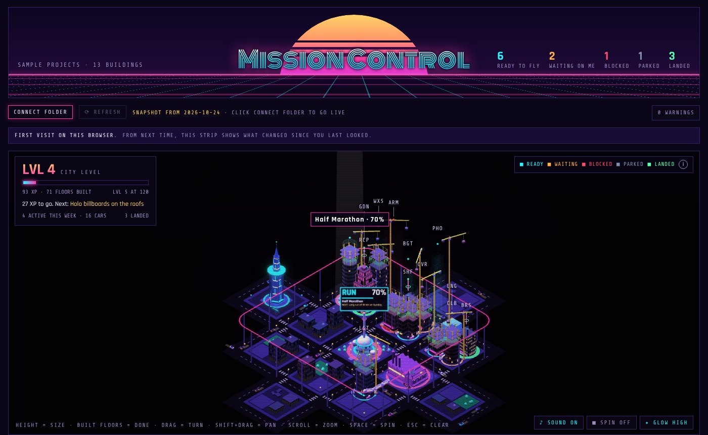

# Mission Control

Turn a folder of markdown project notes into a neon city. Each project is a building. It rises floor by floor as progress goes up, and its lights come on when it lands. The city levels up as you finish things and grows outward block by block.

Everything runs in one HTML file in your browser. Your notes never leave your machine. It works with any folder of markdown notes: Obsidian, VS Code, a synced folder, anything.



## Try it

1. Download `mission-control.html` from the latest [Release](../../releases/latest).
2. Open it in Chrome or Edge on a desktop. You see a demo city.
3. Click **CONNECT FOLDER** and pick the folder that holds your project notes.
4. Edit a note, then press **REFRESH**. The city redraws.

Chrome may ask once per session before it reads the folder again: one click on **ALLOW FOLDER ACCESS**. Firefox and Safari can't read folders, so they show the last snapshot (see [Build your own copy](#build-your-own-copy)).

No project notes yet? Copy [`examples/sample-projects/Templates/Project.md`](examples/sample-projects/Templates/Project.md) into your folder and fill it in. With the repo downloaded, you can also connect `examples/sample-projects` to see how a city builds up.

## Write a project note

One note per project, any file name, anywhere in the folder. Only the frontmatter is read.

```markdown
---
type: project
code: GDN
name: "Garden Beds"
northstar: "Three raised beds with drip irrigation."
progress: 40
lane: ready
kind: making
size: M
next: "Buy cedar boards."
waiting_on: ""
created: 2026-09-01
updated: 2026-10-20
---
# Garden Beds

Write anything you like below the frontmatter.
```

| Field | Needed | Values | What it does |
| --- | --- | --- | --- |
| type | Yes | `project` | Makes the note a building |
| lane | Yes | ready, waiting, blocked, parked, landed | Status colour. `status: completed` lands it; `status: parked` parks it |
| created | Recommended | YYYY-MM-DD | Places the building, oldest at the centre. Set it once, never change it |
| progress | Recommended | 0 to 100 | Share of floors built |
| size | Recommended | S, M, L, XL | Height: 6, 10, 16 or 24 floors. Default M |
| kind | Recommended | software, making, hardware, career, athletics | Building shape and landmark |
| northstar | Recommended | One line | What the project is building |
| next | Recommended | One line | The next step |
| updated | Recommended | YYYY-MM-DD | Last real progress. Dark after 30 days, rust after 60. Falls back to the file's modified date |
| code | Optional | 3 letters | Call sign on the building. Default: first 3 letters of the name |
| name | Optional | Text | Display name. Default: the first `# ` heading, then the file name |
| waiting_on | Optional | Text | Lists the project under what needs you |
| completed | When landed | YYYY-MM-DD | Landing date, with `status: completed`. Use the day you finish (see below) |

Keep the frontmatter simple: one `key: value` per line, lists as `[a, b]` or `- item`. No multi-line values (`>` or `|`) and no nested keys. A comment after a number (`progress: 60 # guess`) reads as 0. Problems show in the **WARNINGS** panel at the top right.

Folders that are never read: hidden ones (`.obsidian`, `.git`, `.trash`), `node_modules`, and any folder named `Templates`, so a template note there never becomes a building. A folder you list in the settings note's `folders` is read even if its name would be skipped.

## Optional settings

Put a note called `mission-control.md` at the root of the folder. Only its frontmatter is read, and every key can be left out.

```markdown
---
title: "My projects"
folders: [Projects, Archive]
links: obsidian
---
```

| Key | Default | What it does |
| --- | --- | --- |
| title | MY PROJECTS | The name in the header |
| folders | The whole folder | Only read these folders. Faster on a big folder |
| links | `obsidian` when the folder has `.obsidian/`, else `none` | A link to open each note in Obsidian; `none` shows the note's path |
| obsidianVault | The folder's name | The vault name in Obsidian links |
| out | `Mission Control.html` | Where `build.py` writes the page, relative to the folder |

## Build your own copy

Needs Python 3. Nothing is installed: the build uses the standard library only, in a venv inside this repo.

- Windows: double-click `build.bat`.
- macOS or Linux: run `./build.sh`.

The first run asks for your folder and remembers it in `.mc-folder` (delete that file to pick another). It writes `Mission Control.html` into your folder with your projects built in as a snapshot. Use it for Firefox, Safari or a phone, or to keep the page next to your notes. You can also pass the folder each time: `python build.py --folder PATH`.

Check your notes without writing anything:

```
python build.py --folder PATH --check
```

It prints the project counts and every warning.

## Privacy

The page makes no network requests. Fonts, three.js and the 3D models are built into the file. Folder access is read-only, granted by you in the browser, and kept only in that browser. Nothing is ever written to your folder by the page.

## How the city works

- A building's place comes from its `created` date: the oldest sit round the town square, newer ones go outward block by block. Progress, status and landing never move a building, as long as `created` and `completed` are the real dates: a back-dated one moves the buildings started after it, once.
- Height comes from `size`; the lit, finished floors from `progress`. Above them: scaffold, a steel frame, then a hologram blueprint of the rest.
- Status shows on the ring round each building: cyan ready, orange waiting, red blocked, steel parked, green landed. Only landed buildings have their lights on.
- City XP is every built floor, plus the building's floors again when it lands. Every 30 XP is a level, and every level adds something to the city.
- The first landing of each kind builds that kind's landmark on a block of its own.
- The page remembers what it showed last time, in this browser, and plays what changed since: new floors light up one by one, and landings get their moment.

All the rules are in [docs/city-rules.md](docs/city-rules.md).

## Requirements and limits

- Live refresh needs Chrome or Edge on a desktop (Windows, macOS or Linux). Firefox, Safari and phones show the snapshot.
- On a slow machine, set the **GLOW** button to LOW or OFF. Add `#fps` to the page address for a frame-rate readout.
- Links into Obsidian work on any machine that has the vault open in Obsidian.

## Development

```
template/mission-control.template.html   the page: city, panels, live refresh
template/vault-parser.js                 the in-page parser (inlined by the build)
build.py                                 the same parser in Python, the build and --check
vendor/                                  three.js r128, GLTFLoader, fonts (with their licences)
assets/models/                           the 3D hero pieces, inlined by the build
tools/                                   Blender scripts that build the pieces, and the model cleanup
examples/sample-projects/                the demo city, the test data, and a note template
tests/                                   the test suite
```

`build.py` and `template/vault-parser.js` must give the same result on any folder. The tests check that, and the city itself, in headless Chromium:

```
npm install
npx playwright install chromium
node tests/run_tests.cjs                     # on examples/sample-projects
node tests/run_tests.cjs --vault PATH        # on your own folder too
```

Needs Node 20 or later. The tests write to `tests/out/` only, never to the folder they read.

The 3D pieces are built from primitives in Blender (`tools/make-*.py`, headless `bpy`). `npm run models` rebuilds `assets/models/` from `assets/meshy-raw/`. To swap a piece, drop a GLB of the same name into `assets/meshy-raw/` and run it.

A tag that starts with `v` builds the demo page and attaches it to a GitHub Release.

## Licence

MIT. See [LICENSE](LICENSE). three.js and GLTFLoader are MIT, the fonts are SIL Open Font License; their licences are in `vendor/`.
